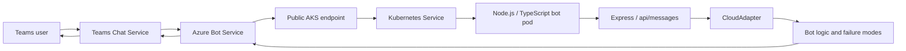

# Teams Bot AKS Failure POC

This private proof-of-concept recreates a Teams bot failure pattern where Teams accepts a user message, Azure Bot Service forwards the activity, the Linux AKS-hosted Node.js bot receives it, and the application then fails before returning a bot-authored response.



## Prerequisites

- Azure CLI, Docker, kubectl, GitHub CLI, Node.js 20+
- Azure permissions: Contributor on the target subscription/resource group, User Access Administrator if role assignments fail, and permission to register resource providers.
- GitHub permissions: ability to create private repositories and configure repository secrets.
- Teams tenant policy allowing custom app upload/sideloading for testing.

## Required provider registrations

```powershell
az provider register --namespace Microsoft.ContainerService
az provider register --namespace Microsoft.ContainerRegistry
az provider register --namespace Microsoft.BotService
az provider register --namespace Microsoft.Insights
az provider register --namespace Microsoft.KeyVault
az provider register --namespace Microsoft.ManagedIdentity
```

## Deployment

```powershell
.\scripts\deploy-infra.ps1 -SubscriptionId "<subscription-id>" -Location "eastus" -ResourceGroupName "rg-teams-bot-aks-poc"
.\scripts\build-and-push-image.ps1 -ResourceGroupName "rg-teams-bot-aks-poc"
.\scripts\deploy-aks.ps1 -ResourceGroupName "rg-teams-bot-aks-poc" -PublicBotHost "<host-name-or-ip>"
.\scripts\configure-bot.ps1 -ResourceGroupName "rg-teams-bot-aks-poc" -PublicBotHost "<host-name-or-ip>"
```

The bot messaging endpoint is:

```text
https://<public-bot-host>/api/messages
```

## Failure reproduction

Normal mode:

```powershell
.\scripts\reproduce-failure.ps1 -ResourceGroupName "rg-teams-bot-aks-poc" -FailureMode none
```

Controlled failure modes:

```powershell
.\scripts\reproduce-failure.ps1 -ResourceGroupName "rg-teams-bot-aks-poc" -FailureMode http500-before-reply
.\scripts\reproduce-failure.ps1 -ResourceGroupName "rg-teams-bot-aks-poc" -FailureMode http500-after-receive
.\scripts\reproduce-failure.ps1 -ResourceGroupName "rg-teams-bot-aks-poc" -FailureMode econnreset-on-reply
.\scripts\reproduce-failure.ps1 -ResourceGroupName "rg-teams-bot-aks-poc" -FailureMode timeout-before-reply
.\scripts\reproduce-failure.ps1 -ResourceGroupName "rg-teams-bot-aks-poc" -FailureMode random-intermittent
```

Send a Teams message to the bot after changing the failure mode. Expected evidence is in pod logs and Application Insights traces: inbound activity received, correlation fields logged, controlled exception thrown, HTTP 500 surfaced, and no bot-authored reply returned.

## Log collection

```powershell
.\scripts\collect-logs.ps1 -ResourceGroupName "rg-teams-bot-aks-poc"
```

This captures pod logs, previous pod logs, Kubernetes events, deployments, services, endpoints, and recent Application Insights trace query commands.

## Cleanup

```powershell
.\scripts\cleanup.ps1 -ResourceGroupName "rg-teams-bot-aks-poc"
```

Cleanup deletes the resource group and all Azure resources created by this POC.

